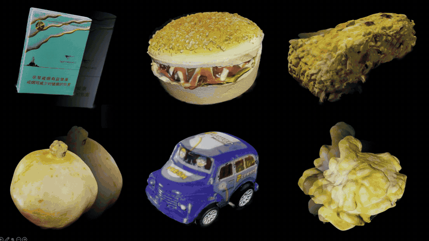

<h1 align="center">🌐 InfiniSplat v3 (SplatAnything)</h1>
<h3 align="center">Gaussian Spacing Normalization for Feed-Forward 3DGS across Arbitrary Scenes</h3>

<p align="center">
  <a href="https://ritianyu.github.io/">Hao Yu</a><sup>1,2</sup> ·
  <a href="https://zhenwwang.github.io/">Zhenwei Wang</a><sup>2</sup> ·
  <a href="https://github.com/Edisoneh">Yongzhen Hu</a><sup>1</sup> ·
  Yuning Gong<sup>2</sup> ·
  Junta Wu<sup>2</sup>
  <br>
  <a href="https://xzhou.me/">Xiaowei Zhou</a><sup>1</sup> ·
  <a href="http://www.cad.zju.edu.cn/home/bao/">Hujun Bao</a><sup>1</sup> ·
  <a href="https://tengfei-wang.github.io/">Tengfei Wang</a><sup>2,†</sup> ·
  <a href="https://openreview.net/profile?id=~Chunchao_Guo1">Chunchao Guo</a><sup>2,†</sup> ·
  <a href="https://pengsida.net/">Sida Peng</a><sup>1,3</sup>
</p>
<p align="center">
  <sup>1</sup>Zhejiang University &nbsp; <sup>2</sup>Tencent Hunyuan &nbsp; <sup>3</sup>Causa Robotics<br>
  <sub>† Corresponding authors</sub>
</p>

<p align="center">
  <a href="https://zju3dv.github.io/SplatAnything/"></a>
  <a href="https://arxiv.org/html/2611.08264"></a>
  <a href="https://huggingface.co/spaces/ritianyu/SplatAnything"></a>
  <a href="https://huggingface.co/ritianyu/SplatAnything/tree/main"></a>
</p>

<p align="center">
  <a href="https://zju3dv.github.io/SplatAnything/#demo"></a>
  <br>
</p>

<p align="center">
  <a href="#news">News</a> ·
  <a href="#what-can-splatanything-do">Capabilities</a> ·
  <a href="#installation">Installation</a> ·
  <a href="#weights">Weights</a> ·
  <a href="#inputs">Inputs</a> ·
  <a href="#splatanything-inference">Inference</a> ·
  <a href="#application">Application</a> ·
  <a href="#parameter-explanation">Parameters</a> ·
  <a href="#citation">Citation</a>
</p>

<a name="news"></a>

## 🌟 About InfiniSplat v3

InfiniSplat series are dedicated to developing high-quality feed-forward 3D Gaussian reconstruction models for autonomous driving, robot navigation, AR/VR and game development. All future development and updates for the InfiniSplat series take place in the [InfiniSplat repository](https://github.com/zju3dv/InfiniSplat). Please star and clone the main repository to follow the latest releases.

<a name="what-can-InfiniSplat v3-do"></a>

## 🧩 What can InfiniSplat v3 do?

**One model, across arbitrary scenes.**

From everyday objects and human subjects to expansive aerial views, InfiniSplat v3 turns simple captures into 3D Gaussian scenes.

It also supports **Rig-Recon** for autonomous driving and **Pano-Recon** for AR/VR, enabling 3D reconstruction from multi-camera rigs and 360° panoramas.

<table align="center" width="100%">
  <tr>
    <td width="25%" align="center" valign="top">
      <h3>🧸</h3>
      <strong>Objects & Humans</strong><br>
    </td>
    <td width="25%" align="center" valign="top">
      <h3>🛋️</h3>
      <strong>Indoor Scenes</strong><br>
    </td>
    <td width="25%" align="center" valign="top">
      <h3>🏙️</h3>
      <strong>Street Scenes</strong><br>
    </td>
    <td width="25%" align="center" valign="top">
      <h3>🛰️</h3>
      <strong>Aerial Scenes</strong><br>
    </td>
    <td width="25%" align="center" valign="top">
      <h3>🚓</h3>
      <strong>Rig-Recon</strong><br>
    </td>
    <td width="25%" align="center" valign="top">
      <h3>🥽</h3>
      <strong>Pano-Recon</strong><br>
    </td>
  </tr>
</table>


<a name="installation"></a>

## ⚙️ Installation

Use Python 3.10+ and PyTorch 2.4+ with a CUDA build compatible with your NVIDIA driver. Install PyTorch first, then:

```bash
git clone https://github.com/zju3dv/InfiniSplat.git
cd InfiniSplat/InfiniSplat_v3
python -m pip install -r requirements.txt
```

## Weights

Prepare these files locally. Public weight can be downloaded from [Hugging Face](https://huggingface.co/ritianyu/SplatAnything):

```text
checkpoints/
├── SplatAnything.ckpt          # complete Gaussian student
├── worldmirror2.safetensors    # WorldMirror-2 geometry weights
└── skyseg.onnx                 # optional sky segmentation
```

## Inputs

Use a scene directory containing overlapping RGB images in `images/`. Pose-conditioned mode also requires `prior_camera.json` in that directory; RGB mode ignores this file. See [prepare_data.md](docs/prepare_data.md) for scene layout, camera conversion, and panorama preparation.

One example scene is included per category: [object](examples/object/), [indoor](examples/indoor/), [street](examples/street/), [aerial](examples/aerial/), [rig](examples/rig/), and [pano](examples/pano/). Each category directory contains its images and camera JSON directly:

```text
examples/object/
├── images/
└── prior_camera.json
```

<a name="InfiniSplat v3-inference"></a>

## 🚀 Inference

Point `--input_path` at a scene directory and choose a mode. Inference uses all images in `images/`, with a default resolution of **756 × 756**。 You can also specify a different resolution with `--resolution W H` (supports input resolutions of 1K and above).

```bash
# RGB-only: 
python inference.py \
  --input_path examples/object \
  --mode rgb \
  --output_path outputs/object/rgb

# Pose-conditioned: 
python inference.py \
  --input_path examples/object \
  --mode pose \
  --output_path outputs/object/pose
```

Use any scene directory under `examples/` in the same way.

For your own scene:

```bash
python inference.py \
  --input_path /path/to/my_scene \
  --mode rgb \
  --output_path outputs/my_scene
# For pose mode, place prior_camera.json in the scene directory and use --mode pose.
```

Outputs include `gaussians.ply`, `points.ply`, cameras, RGB, and depth under `OUTPUT/SCENE/`. Choose different output roots to keep scenes and modes separate. See the [inference reference](docs/inference.md) for export formats and all options.

## Application

### Rig-Recon for Autonomous Driving · Surround-view cameras

Reconstruct scenes captured by a calibrated multi-camera rig, including autonomous-driving surround views.

```bash
python inference.py \
  --input_path examples/rig \
  --mode pose \
  --resolution 504 504 \
  --output_path outputs/rig/pose
```

This command reconstructs all 150 rig views at 504 × 504. [Camera preparation](docs/prepare_data.md#prepare-your-camera-inputs)

### Pano-Recon for AR / VR · From 360° to 3D

Turn an equirectangular panorama into **24 calibrated perspective views**, then reconstruct with the same inference entry point.

```bash
python scripts/convert_panorama.py \
  --input data/panorama.jpg \
  --output data/my_pano
  
python inference.py \
  --input_path data/my_pano \
  --mode pose
```

To use the prepared panorama example, replace `data/my_pano` above with `examples/pano`. All 24 perspective views are used. See [panorama preparation and view layout](docs/prepare_data.md#panorama-to-24-perspective-views).

## Parameter Explanation

| Option | Purpose |
|---|---|
| `--mode rgb` / `--mode pose` | Predict cameras, or use supplied poses and intrinsics |
| `--resolution W H` | Model input size; defaults to `756 756`, with positive multiples of 14 |
| `--sky_seg` | Remove sky; requires the optional ONNX model |
| `--opacity_thresh` | Minimum opacity retained in the exported Gaussian PLY |

See **[the full inference reference](docs/inference.md)** for defaults, checkpoints, filtering, voxel merging, and output coordinates. Run `python inference.py --help` for CLI options.

<a name="acknowledgements"></a>

## 🙏 Acknowledgements

We thank [Jiawei Wang](https://plus-wave.github.io/) and [Yujie Guo](https://guoyujie.cn/) for insightful discussions and valuable feedback.

## Citation

If you find InfiniSplat v3 useful in your research, please cite:

```bibtex
@article{yu2026splatanything,
  title={SplatAnything: Gaussian Spacing Normalization for Feed-Forward 3DGS across Arbitrary Scenes},
  author={Yu, Hao and Wang, Zhenwei and Hu, Yongzhen and Gong, Yuning and Wu, Junta and Zhou, Xiaowei and Bao, Hujun and Wang, Tengfei and Guo, Chunchao and Peng, Sida},
  journal={arXiv preprint},
  year={2026}
}
```
